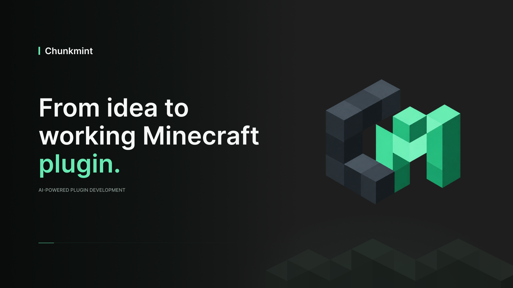

<p align="center">
  
</p>

<h1 align="center">Chunkmint.dev</h1>

<p align="center">
  <strong>From idea to working Minecraft plugin.</strong>
</p>

<p align="center">
  Build, edit, test and ship Minecraft plugins with AI.
</p>

<p align="center">
  <a href="https://chunkmint.dev">Website</a>
  ·
  <a href="https://chunkmint.dev/docs">Docs</a>
  ·
</p>

---

## What is Chunkmint?

Chunkmint.dev is an AI-native workspace for creating Minecraft plugins.

Describe what you want to build and Chunkmint can help you:

- plan the plugin
- generate source code
- edit the project in-browser
- build the plugin
- test it on a real temporary Minecraft server
- fix build or runtime errors
- download the final `.jar`
- export the source code to GitHub

---

## From prompt to `.jar`

```text
Prompt
→ Plan
→ Generate
→ Edit
→ Build
→ Test
→ Fix
→ Download
```

Chunkmint is designed to go beyond simple code generation.

Generated plugins can be compiled and launched inside a temporary Minecraft test environment before you download them.

---

## Features

- AI-powered Minecraft plugin generation
- Built-in source code editor
- Real project files and version history
- Paper / Purpur workflow
- Automated builds
- Runtime testing
- Interactive test servers
- AI-assisted error fixing
- GitHub export
- Shareable projects
- Plugin templates
- Documentation-aware AI

---

## Test your plugin in-game

Chunkmint can launch a temporary Minecraft server for your project.

You can join it directly from Minecraft and test your plugin before shipping it.

No local Java setup, server setup, FTP or SSH required.

---

## GitHub export

Your code stays accessible.

Export your Chunkmint project to your own GitHub repository whenever you want to continue development outside the platform.

---

## Built for Minecraft creators

Chunkmint is useful for:

- server owners
- plugin developers
- Minecraft communities
- creators building custom server mechanics

Whether you are creating a small command or a larger server system, the goal is the same:

> **Build. Test. Ship.**

---

<p align="center">
  <a href="https://chunkmint.dev"><strong>Start building with Chunkmint →</strong></a>
</p>
